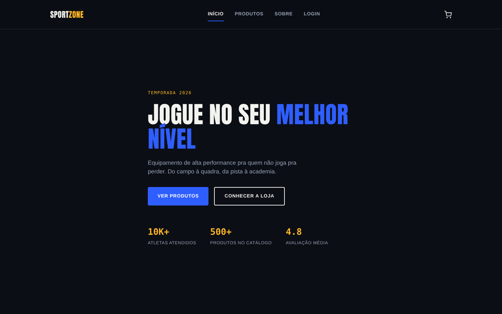

# SportZone

Loja virtual de artigos esportivos feita em **React**. Tem catálogo com busca e filtros, carrinho de compras com estado global e navegação entre páginas com React Router.



## Tecnologias

| Para quê | Ferramenta |
| --- | --- |
| Interface | React 19 |
| Rotas | React Router |
| Estado do carrinho | Context API |
| Build e servidor de desenvolvimento | Vite |

## Funcionalidades

- **Catálogo** com 10 produtos em 6 categorias: futebol, corrida, basquete, fitness, vôlei e skate
- **Busca** por nome, **filtro** por categoria e **ordenação**
- **Carrinho** com estado global (Context API): adicionar, remover e alterar a quantidade
- Páginas de início, produtos, sobre, login e carrinho
- Página **404** para rotas que não existem
- Componentes reutilizáveis, como o card de produto

## Estrutura

Cada componente tem a sua pasta, com o JSX e o CSS juntos.

```
LojaVirtual/src/
  components/
    navbar/  introducao/  home/  produtos/  produtoCard/
    carrinho/  login/  sobre/  rodape/  naoencontrado/
  context/CarrinhoContext.jsx   estado global do carrinho
  data/produtos.js              dados dos produtos
  App.jsx                       rotas
```

## Como rodar

Pré-requisito: Node.js 18 ou mais novo.

```bash
git clone https://github.com/miguelhenricoelho/SportZone.git
cd SportZone/LojaVirtual
npm install
npm run dev
```

Abra o endereço que aparecer no terminal (normalmente **http://localhost:5173**).

## Autor

**Miguel Henriques Coelho** · Ciência da Computação, Unifor
[GitHub](https://github.com/miguelhenricoelho) · [LinkedIn](https://www.linkedin.com/in/miguel-henriques-coelho-05686b3a7)
